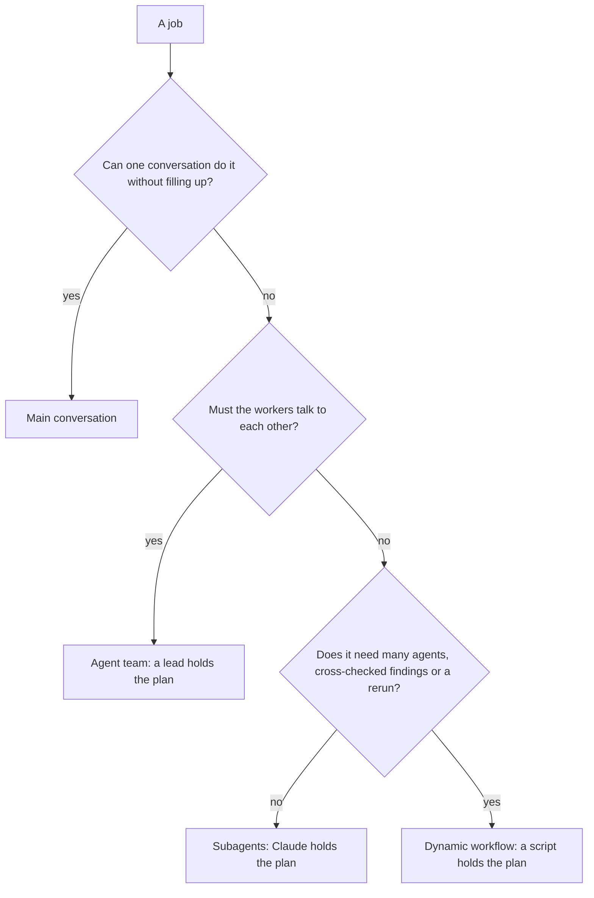

# Choose an orchestration pattern

<sub>**Advanced** · Lesson 2 of 7 · about 20 minutes · Needs: [Parallel sessions with worktrees](01-parallel-sessions.md) · Verified against Claude Code v2.1.285 (stable) on 2026-10-09</sub>

## Goal

К концу этого урока вы сможете выбирать между основным диалогом, субагентами, динамическим воркфлоу и командой агентов в зависимости от требований задачи и сопутствующих расходов, а также запускать задачу в виде параллельных субагентов. <details style="display:inline"><summary><code>[en]</code></summary>By the end of this lesson you can choose between the main conversation, subagents, a dynamic workflow and an agent team by what a job needs and what it costs, and run a job as parallel subagents.</details>

## You need

- Ваш репозиторий из [Урока 1](01-parallel-sessions.md), содержащий как минимум три директории верхнего уровня с файлами, а также копия учебного шаблона с Node.js LTS: скрипт проверки вызывается из копии. Настройте папку `.practice/` в соответствии с описанием в [Уроке 1 уровня Beginner](../beginner/01-install-and-look-around.md#you-need), если еще не сделали этого.
- macOS, Linux или WSL 2, а также утилита `jq`: лог делегирования в разделе Ваша очередь представляет собой команду оболочки с ее использованием.
- Расход токенов: умеренный (moderate). Каждый субагент работает в собственном контекстном окне и отправляет отдельные запросы, учитываемые в общих лимитах вашей основной сессии ([Create custom subagents](https://code.claude.com/docs/en/sub-agents)). Для экономии токенов используйте две папки в пошаговом примере и два файла в задании 1.

## The idea

Субагенты, динамические воркфлоу и команды агентов разделяют выполнение работы между несколькими исполнителями; ключевое отличие заключается в том, кто управляет планом ([When to use a workflow](https://code.claude.com/docs/en/workflows#when-to-use-a-workflow)). В случае субагентов Claude принимает решения раунд за раундом, и каждый результат возвращается обратно в ваш основной диалог. Динамический воркфлоу представляет собой скрипт, написанный Claude: он содержит логику цикла и промежуточные результаты, благодаря чему может запускать множество агентов, сопоставлять их выводы и воспроизводить процесс в точности так же. В команде агентов ведущий координирует участников, напрямую обменивающихся сообщениями друг с другом ([Choose an approach](https://code.claude.com/docs/en/agents#choose-an-approach)).

Любой паттерн сложнее одного диалога увеличивает расход токенов: каждый субагент и каждый агент, порожденный воркфлоу, отправляет собственные запросы ([Why usage climbs](https://code.claude.com/docs/en/costs#why-usage-climbs-in-a-long-session)), а команды агентов расходуют существенно больше токенов по сравнению с одиночной сессией ([When to use agent teams](https://code.claude.com/docs/en/agent-teams#when-to-use-agent-teams)). Поэтому выбирайте наименее затратный паттерн, достаточный для решения задачи: последовательно отвечайте на следующие вопросы диаграммы и останавливайтесь на первом ответе, дающем решение.



> [!NOTE]
> Команды агентов являются экспериментальной возможностью и отключены по умолчанию ([Orchestrate teams of Claude Code sessions](https://code.claude.com/docs/en/agent-teams)). В этом уроке они рассматриваются как один из вариантов выбора, но не запускаются на практике; их практическая настройка выполняется в факультативе [Команды агентов](electives/agent-teams.md).

## Worked example

1. Выберите три директории верхнего уровня в вашем репозитории, например `src`, `test` и `docs`, и запустите `claude`.
2. Задайте вопросы из схемы для одной задачи: составление вводного резюме по каждой папке для нового разработчика. Один диалог быстро заполнится чтением файлов, которые больше не понадобятся, поэтому основной диалог не подходит ([Choose between subagents and main conversation](https://code.claude.com/docs/en/sub-agents#choose-between-subagents-and-main-conversation)). Исполнителям не нужно общаться между собой, поэтому команда агентов избыточна. Это три задачи, выполняемые один раз, поэтому подходят параллельные субагенты.
3. Запросите анализ с именами ваших папок, как показано в примере параллельного исследования из документации ([Run parallel research](https://code.claude.com/docs/en/sub-agents#run-parallel-research)):

   ```text
   Research the src, test and docs folders in parallel using separate subagents, and give me two sentences on each.
   ```

   По умолчанию интерактивная сессия запускает субагентов в фоновом режиме, сохраняя строку ввода свободной ([Run subagents in foreground or background](https://code.claude.com/docs/en/sub-agents#run-subagents-in-foreground-or-background)). Панель под строкой ввода показывает отдельную строку для каждого работающего субагента.
4. Пока они работают, выполните команду `/tasks`. Она выводит список всех субагентов с их статусом и используемой моделью; нажатие Enter на строке открывает полный журнал работы субагента ([Check on running work](https://code.claude.com/docs/en/agents#check-on-running-work), [Choose a model](https://code.claude.com/docs/en/sub-agents#choose-a-model)). Claude может запустить встроенных субагентов `Explore` или `general-purpose` ([built-in subagents](https://code.claude.com/docs/en/sub-agents#built-in-subagents)), либо ответвления текущей сессии (forks). Когда субагент успешно завершает задачу, его строка исчезает из панели, а в строке состояния кратко отображается `/tasks to see subagents`.
5. После получения всех резюме выполните `/usage`. На планах Pro, Max, Team или Enterprise детализация использования показывает распределение расходов токенов между навыками, субагентами, плагинами и серверами MCP, а также предупреждает о факторах вроде длинного контекста ([Plan usage breakdown](https://code.claude.com/docs/en/costs#plan-usage-breakdown)). Блок Session для пользователей API (например, вошедших через Console) отображает расчетную стоимость текущей сессии ([Using the `/usage` command](https://code.claude.com/docs/en/costs#using-the-%2Fusage-command)). Оба значения являются приблизительными оценками.
6. Обратите внимание, что изменило бы выбор: аналогичный анализ для каждой папки с перепроверкой результатов и регулярным повторением перед каждым релизом потребовал бы динамического воркфлоу (тема следующего урока). А ситуация, когда ревьюеры должны обсуждать и оспаривать первопричину проблемы между собой, потребовала бы команды агентов.

## Your turn

**Задание:** перед вами четыре задачи для вашего репозитория. Выберите подходящий паттерн для каждой, исходя из функциональных требований и стоимости, запишите ваш выбор, а затем выполните на практике ту задачу, которая требует субагентов.

1. Проверить три самых больших файла исходного кода на наличие перехваченных и проигнорированных ошибок. Чтение этих файлов в основном диалоге перегрузило бы контекст, при этом вам нужен только итоговый список: один ревьюер на файл, однократный запуск и краткий отчет на выходе.
2. Провести аналогичную проверку для каждого исходного файла проекта, верифицировать каждое замечание по коду перед отправкой в отчет и перезапускать эту проверку перед каждым релизом.
3. Исправить опечатку в одном сообщении об ошибке.
4. Три исследователя параллельно проверяют разные гипотезы относительно нестабильного теста (flaky test), переписываются друг с другом по ходу работы для верификации выводов и продолжают обсуждение до тех пор, пока не придут к согласию о причине сбоя.

**Критерии приемки:**

- Файл `.practice/a-2-choices.md` содержит по одной строке для каждой задачи в формате `<job number>: <pattern> because <reason>`, где паттерн принимает одно из значений: `main conversation`, `subagents`, `workflow` или `agent team`.
- Файл `.practice/a-2-hook.json` содержит хук [`SubagentStart`](https://code.claude.com/docs/en/hooks#subagentstart), записывающий идентификатор и тип каждого субагента в `.practice/a-2-agents.txt` при старте, аналогично логу делегирования из [Урока 6 уровня Intermediate](../intermediate/06-subagents.md):

  ```json
  {
    "hooks": {
      "SubagentStart": [
        { "hooks": [ { "type": "command", "command": "jq -r '[.agent_id, .agent_type] | @tsv' >> \"$CLAUDE_PROJECT_DIR/.practice/a-2-agents.txt\"" } ] }
      ]
    }
  }
  ```

- Задача 1 выполнена через параллельных субагентов (по одному на файл) в сессии, запущенной с флагом `claude --settings .practice/a-2-hook.json` ([CLI reference](https://code.claude.com/docs/en/cli-reference#cli-flags)).
- Задача 1 не изменила ни одного файла: ревьюеры сформировали только отчет, и `git status` не показывает изменений.
- Запущена на выполнение только задача 1. Остальные три задачи представлены только выбором паттерна в файле.

## Check

Задание выполнено, когда выполняются все условия:

- [ ] Файл `.practice/a-2-choices.md` содержит наименее затратный подходящий паттерн для каждой задачи.
- [ ] Файл `.practice/a-2-agents.txt` фиксирует запуск как минимум двух субагентов для задачи 1: команда `cut -f1 .practice/a-2-agents.txt | sort -u` выводит два или более идентификаторов.
- [ ] Самопроверка (не тестируется): для одной реальной задачи из вашего бэклога вы можете назвать паттерн, определяющий вопрос из схемы и причину, по которой более дешевый вариант не подошел.

Запустите команду `npm run check -- a-2 --dir <your repo>` из вашей копии учебного шаблона.

Если выбор паттерна для задачи неверен, последовательно ответьте на вопросы блок-схемы: подсказка проверки укажет на ключевой развилочный вопрос. Если лог содержит менее двух идентификаторов, запустите сессию с файлом настроек хука и явно попросите запустить по одному параллельному субагенту на файл. Если Claude возобновляет работу ранее остановленного субагента, событие запишет его id повторно, поэтому уникальные id учитываются по одному разу.

## Watch out

- Запросы разрешений фонового субагента отображаются в вашей основной сессии, а разрешение, выходящее за рамки одного вызова (например, подтверждение до конца сессии), распространяется на всю сессию целиком, включая основной диалог ([Run subagents in foreground or background](https://code.claude.com/docs/en/sub-agents#run-subagents-in-foreground-or-background)). Одобряйте такие запросы только на один вызов инструмента и инструктируйте ревьюеров ограничиться исключительно чтением.
- Результат каждого субагента возвращается в ваш основной диалог, при этом каждый субагент расходует токены во время выполнения: слишком подробные отчеты быстро перегрузят ваш контекст. Требуйте от субагентов кратких и емких выводов ([Run parallel research](https://code.claude.com/docs/en/sub-agents#run-parallel-research)).
- При включенных командах агентов субагент, к которому обращается Claude, может запускаться как участник команды (teammate), из-за чего может сформироваться полноценная команда вместо одиночных субагентов. Хук также записывает строку каждый раз, когда участник команды в основном терминале обрабатывает новое сообщение ([Claude spawns teammates instead of subagents](https://code.claude.com/docs/en/agent-teams#claude-spawns-teammates-instead-of-subagents), [SubagentStart](https://code.claude.com/docs/en/hooks#subagentstart)). Если вы включали команды агентов, добавьте `"env": { "CLAUDE_CODE_EXPERIMENTAL_AGENT_TEAMS": "0" }` в `.practice/a-2-hook.json` на верхний уровень рядом с `"hooks"`. Файл из параметра `--settings` имеет приоритет над настройками пользователя, проекта, локальными файлами и переменными оболочки; выше него по приоритету только политики managed settings ([Settings precedence](https://code.claude.com/docs/en/settings#settings-precedence)).

## Go further

- [Параллельный запуск агентов](https://code.claude.com/docs/en/agents): официальное сравнение способов одновременной работы над несколькими задачами и методов отслеживания прогресса.
- [Ответвление текущего диалога (Fork)](https://code.claude.com/docs/en/sub-agents#fork-the-current-conversation): субагент, наследующий полную историю диалога и разделяющий кэш промптов для побочной задачи в том же контексте.
- [Стоимость токенов в командах агентов](https://code.claude.com/docs/en/costs#agent-team-token-costs): факторы роста потребления токенов при командной работе и способы оптимизации расходов.

---

<sub>Sources: [Run agents in parallel](https://code.claude.com/docs/en/agents) · [Orchestrate subagents at scale with dynamic workflows](https://code.claude.com/docs/en/workflows) · [Orchestrate teams of Claude Code sessions](https://code.claude.com/docs/en/agent-teams) · [Create custom subagents](https://code.claude.com/docs/en/sub-agents) · [Manage costs effectively](https://code.claude.com/docs/en/costs) · [Hooks reference](https://code.claude.com/docs/en/hooks) · [CLI reference](https://code.claude.com/docs/en/cli-reference) · [Settings files and precedence](https://code.claude.com/docs/en/settings)</sub>

<sub>← [Параллельные сессии с worktrees](01-parallel-sessions.md) · [Advanced index](README.md) · [Запуск и сохранение динамического воркфлоу](03-dynamic-workflows.md) → · Topic: [Субагенты и параллельная работа](../topics/subagents-and-parallel-work.md) · [Stuck on this lesson?](https://github.com/wesammustafa/Claude-Code-Everything-You-Need-to-Know/issues/new?template=lesson-feedback.yml&lesson=a-2)</sub>
