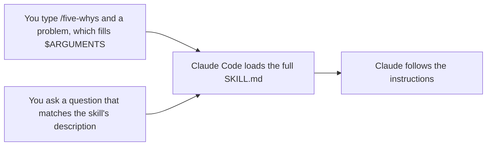

# Turn a repeated workflow into a skill

<sub>**Intermediate** · Lesson 1 of 8 · about 20 minutes · Needs: [Intermediate index](README.md) · Verified against Claude Code v2.1.285 (stable) on 2026-10-06</sub>

## Goal

К концу этого урока вы сможете превратить часто повторяемый рабочий процесс в навык (skill) проекта, который запускается при вводе его имени и подгружается автоматически, когда запрос пользователя соответствует его описанию. <details style="display:inline"><summary><code>[en]</code></summary>By the end of this lesson you can turn a workflow you keep repeating into a project skill that runs when you type its name and loads on its own when a request matches it.</details>

## You need

- Один из ваших рабочих репозиториев с настроенной командой запуска тестов и чистым рабочим деревом git, а также ваша учебная копия репозитория с Node.js LTS (проверка запускается из неё). Чтобы практиковаться непосредственно в шаблоне, используйте его для обеих ролей. Настройте папку `.practice/`, как описано в [уроке 1 уровня Beginner](../beginner/01-install-and-look-around.md#you-need), если вы ещё этого не сделали.
- Расход токенов: от минимального до умеренного. В разделе Your turn реализуется одна небольшая функция.

> [!NOTE]
> Начиная с этого уровня, уроки ориентированы на macOS, Linux и WSL 2. На Windows запускайте Claude Code внутри WSL 2 ([Set up on Windows](https://code.claude.com/docs/en/setup#set-up-on-windows)): в нативной Windows отсутствует механизм песочницы (sandbox), используемый в уроке 4, а скрипты хуков в уроке 5 написаны на bash.

## The idea

[Навык (skill)](https://code.claude.com/docs/en/skills) представляет собой папку с файлом `SKILL.md`: YAML-блок frontmatter с описанием назначения навыка и последующий текст инструкций для Claude. Навык проекта размещается по пути `.claude/skills/<name>/SKILL.md`. Закоммитьте его в git, и он станет доступен всем участникам разработки репозитория. <details style="display:inline"><summary><code>[en]</code></summary>A skill is a folder holding a SKILL.md file: YAML frontmatter that says what the skill is for, then the instructions Claude follows. A project skill lives in .claude/skills/<name>/SKILL.md. Commit it, and everyone who works in the repository gets it.</details>

Пока навык не запущен, в контексте Claude находится только его краткое описание. Навык может выполняться двумя способами, и в обоих случаях Claude Code загружает полный текст файла `SKILL.md`:



- Параметр `disable-model-invocation: true` в блоке frontmatter оставляет доступным только первый способ запуска (вручную по имени). Используйте его для действий с побочными эффектами (side effects), например деплоя ([Control who invokes a skill](https://code.claude.com/docs/en/skills#control-who-invokes-a-skill)).
- Переменная `$ARGUMENTS` в теле файла получает всё, что вы вводите после названия навыка.
- Файл Markdown в папке `.claude/commands/` - устаревший формат, но он по-прежнему поддерживается и запускается как `/name`. Для новых сценариев всегда предпочитайте полноценные навыки (skills).

## Worked example

1. В вашем репозитории создайте папку для навыка и загрузите пример навыка [`five-whys`](../../examples/intermediate/01-first-skill/dot-claude/skills/five-whys/SKILL.md). Обязательно прочитайте файл перед использованием:

   ```bash
   mkdir -p .claude/skills/five-whys
   curl -fsSL https://raw.githubusercontent.com/wesammustafa/Claude-Code-Everything-You-Need-to-Know/main/examples/intermediate/01-first-skill/dot-claude/skills/five-whys/SKILL.md -o .claude/skills/five-whys/SKILL.md
   ```

   Без учёта комментариев в верхней части frontmatter, файл содержит:

   ```markdown
   ---
   name: five-whys
   description: Finds the root cause of a bug, failure or recurring problem by asking "why" until the answer is a cause you can fix. Use when the user asks why something keeps happening, or wants the root cause rather than a quick fix.
   argument-hint: "[problem]"
   ---

   Find the root cause of this problem: $ARGUMENTS
   ```

   за которым следуют пять пронумерованных шагов расследования и строгое правило "Don't change any files."
2. Запустите `claude` в репозитории и выполните команду `/skills` ([Commands](https://code.claude.com/docs/en/commands)). В списке отобразится `five-whys` с отметкой project skill.
3. Запустите навык по имени, передав проблему из вашего проекта. В учебном шаблоне:

   ```text
   /five-whys npm run linkcheck -- samples exits with code 1
   ```

   Claude воспроизведёт проблему, последовательно задаст вопросы "почему" на основе фактов до выявления первопричины, которую команда в силах устранить, после чего представит цепочку рассуждений, первопричину и два варианта решения. Формулировки могут различаться. Во втором терминале команда `git status` покажет только новые файлы в `.claude/`: навык запретил Claude вносить изменения в кодовую базу.
4. Выполните `/clear`, затем задайте вопрос, соответствующий описанию навыка, не называя сам навык:

   ```text
   Why does the test suite pass even though samples/guide.md has a broken link? I want the root cause, not a quick fix.
   ```

   Перед ответом в транскрипте сессии отобразится вызов инструмента `Skill` для `five-whys`: Claude самостоятельно определил релевантность и подгрузил навык ([Tools reference](https://code.claude.com/docs/en/tools-reference)).

## Your turn

Доработайте заготовку навыка для разработки через тестирование (TDD) и опробуйте оба способа его вызова.

1. Загрузите заготовку навыка [`tdd`](../../examples/intermediate/01-first-skill/dot-claude/skills/tdd/SKILL.md):

   ```bash
   mkdir -p .claude/skills/tdd
   curl -fsSL https://raw.githubusercontent.com/wesammustafa/Claude-Code-Everything-You-Need-to-Know/main/examples/intermediate/01-first-skill/dot-claude/skills/tdd/SKILL.md -o .claude/skills/tdd/SKILL.md
   ```

   В его frontmatter указано `description: TODO` и `disable-model-invocation: true`, а шаги оканчиваются так:

   ```markdown
   2. Green: TODO
   3. Refactor: TODO
   ```

2. В редакторе допишите навык:
   - замените `TODO` в поле `description` одним-двумя предложениями: что делает навык и в каких ситуациях Claude должен его применять;
   - удалите строку `disable-model-invocation: true`;
   - опишите шаги Green и Refactor, соблюдая лаконичный стиль шага Red.
3. Закоммитьте навык в git: `git add .claude/skills/tdd/SKILL.md`, затем `git commit -m "Add a tdd skill"`.
4. В сессии вызовите его по имени для создания небольшой функции. В учебном шаблоне:

   ```text
   /tdd a slugify(heading) function in src/slug.js that turns a Markdown heading into its link anchor: lowercase, punctuation dropped, spaces turned into hyphens
   ```

   Подтвердите создание файлов и запуск тестов, позволив Claude закоммитить изменения. Сохраните хеш этого коммита: `git rev-parse HEAD > .practice/i-1-commit.txt`.
5. Выполните команду `/clear` и попросите реализовать ещё одну небольшую функцию методом TDD, не упоминая название навыка (например, `Add a countHeadings(markdown) function, test-first.`). Убедитесь, что Claude самостоятельно вызвал `tdd` через инструмент `Skill`. Увидев срабатывание, вы можете нажать `Esc` для остановки генерации ([Interactive mode](https://code.claude.com/docs/en/interactive-mode)) и команду `/rewind` для отката правок ([Checkpointing](https://code.claude.com/docs/en/checkpointing)), как в [уроке 4 уровня Beginner](../beginner/04-keep-a-session-on-track.md).

## Check

Задание выполнено, когда выполняются все условия:

- [ ] Завершённый навык закоммичен без оставшихся пометок TODO: команда `git grep -n TODO HEAD -- .claude/skills/tdd` ничего не выводит.
- [ ] Навык может вызываться как `/tdd` и загружаться автоматически: `git show HEAD:.claude/skills/tdd/SKILL.md` содержит описание назначения и условий применения, а параметр `disable-model-invocation: true` отсутствует.
- [ ] Коммит из `.practice/i-1-commit.txt` содержит тесты и реализуемый ими код: `git show --stat $(cat .practice/i-1-commit.txt)` показывает и то, и другое.
- [ ] Self-check (not tested): команда `/tdd` успешно запустила навык, а в очищенном диалоге Claude загрузил `tdd` самостоятельно.

Запустите `npm run check -- i-1 --dir <your repo>` из учебной копии, либо `npm run check -- i-1` в самой учебной копии.

Если навык не закоммичен, выполните `git check-ignore -v .claude/skills/tdd/SKILL.md`: правило игнорирования `.claude` в `.gitignore` или `.git/info/exclude` может скрывать папку от индексации; в таком случае добавьте файл принудительно через `git add -f`. Если не проходит второй пункт, сформулируйте описание в виде сути действий навыка, за которой следует фраза "Use when" с перечислением подходящих запросов пользователя: при принятии решения об автоматической загрузке Claude считывает только поле description. Если не проходит пункт с коммитом, запустите `/tdd` заново для другой небольшой функции и разрешите закоммитить тесты вместе с кодом.

## Watch out

- Навык может заранее разрешать вызов инструментов через `allowed-tools`, и Claude Code применяет права проектного навыка даже при запуске `claude -p` в каталоге, которому вы ещё не подтверждали доверие ([Pre-approve tools for a skill](https://code.claude.com/docs/en/skills#pre-approve-tools-for-a-skill)). Всегда просматривайте навыки в репозитории перед запуском Claude Code.
- Если папки `.claude/skills/` не существовало в момент старта сессии, выполните `/reload-skills`, чтобы Claude Code обнаружил добавленный навык ([Edit a skill during a session](https://code.claude.com/docs/en/skills#live-change-detection)).
- После первого вызова навыка его текст остаётся в истории диалога, и Claude Code не перечитывает файл с диска на каждом шаге. После редактирования навыка вызовите его повторно, чтобы обновить контекст ([Skill content lifecycle](https://code.claude.com/docs/en/skills#skill-content-lifecycle)).

## Go further

- [Introduction to agent skills](https://academy.claude.com/courses/introduction-to-agent-skills): курс Claude Academy по созданию и совместному использованию навыков.
- [Agent Skills](https://agentskills.io): открытый стандарт описания навыков, используемый Claude Code и поддерживаемый другими ИИ-инструментами.
- [Extend Claude with skills](https://code.claude.com/docs/en/skills): полный справочник по полям frontmatter, передаче аргументов, вспомогательным файлам и запуску навыков в субагентах.

---

<sub>Sources: [Extend Claude with skills](https://code.claude.com/docs/en/skills) · [Advanced setup](https://code.claude.com/docs/en/setup) · [Commands](https://code.claude.com/docs/en/commands) · [Tools reference](https://code.claude.com/docs/en/tools-reference) · [Interactive mode](https://code.claude.com/docs/en/interactive-mode) · [Checkpointing](https://code.claude.com/docs/en/checkpointing)</sub>

<sub>← [Intermediate index](README.md) · [Organize project memory and see what loaded](02-organize-memory.md) → · Topic: [Skills](../topics/skills.md) · [Stuck on this lesson?](https://github.com/wesammustafa/Claude-Code-Everything-You-Need-to-Know/issues/new?template=lesson-feedback.yml&lesson=i-1)</sub>
