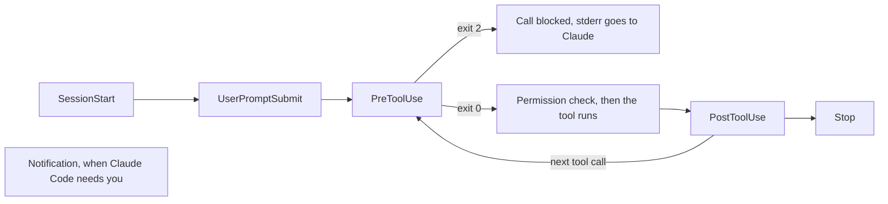

# Enforce a rule with a hook

<sub>**Intermediate** · Lesson 5 of 8 · about 20 minutes · Needs: [Permissions, settings scopes and the sandbox](04-permissions-and-sandbox.md) · Verified against Claude Code v2.1.285 (stable) on 2026-10-06</sub>

## Goal

К концу этого урока вы сможете настроить хук (hook), который проверяет и принудительно исполняет правило при каждом редактировании файла со стороны Claude, и убедиться в его надёжном срабатывании. <details style="display:inline"><summary><code>[en]</code></summary>By the end of this lesson you can add a hook that enforces a rule every time Claude edits a file, and show it firing.</details>

## You need

- Репозиторий из [урока 4](04-permissions-and-sandbox.md) с файлом `.claude/settings.json`, и ваша учебная копия репозитория с Node.js LTS (проверка запускается из неё).
- Пакет `jq`, используемый скриптами хуков, и `python3`, необходимый для скрипта `format-after-edit.sh`.
- Расход токенов: минимальный (light).

## The idea

Правило в `CLAUDE.md` является рекомендацией, которую модель может упустить. [Хук (hook)](https://code.claude.com/docs/en/hooks-guide) - это ваша собственная исполняемая команда, которую Claude Code запускает строго в определённой точке жизненного цикла сессии, каждый раз, независимо от логики Claude. Claude Code передаёт хуку JSON-структуру события через стандартный ввод (stdin). Хук `PreToolUse` выполняется перед вызовом инструмента; если он завершается с кодом возврата 2, вызов блокируется, а текст из stderr отправляется Claude в качестве причины отказа ([Hooks reference](https://code.claude.com/docs/en/hooks#exit-code-2-behavior-per-event), [Block edits to protected files](https://code.claude.com/docs/en/hooks-guide#block-edits-to-protected-files)). <details style="display:inline"><summary><code>[en]</code></summary>A CLAUDE.md rule is advice that Claude can miss. A hook is your own command that Claude Code runs at a fixed point in a session, every time, whatever Claude decides.</details>

События, используемые в уроке, и их место в структуре диалогового хода:



Фильтр `matcher` выбирает инструменты, на которые реагирует хук: шаблон `Edit|Write` запускает хук только для этих двух инструментов ([Filter hooks with matchers](https://code.claude.com/docs/en/hooks-guide#filter-hooks-with-matchers)). Хуки `PreToolUse` срабатывают до проверки режима разрешений, поэтому блокировка действует во всех режимах без исключения ([Hooks and permission modes](https://code.claude.com/docs/en/hooks-guide#hooks-and-permission-modes)).

## Worked example

1. В вашем репозитории загрузите два скрипта из [примеров хуков этого руководства](../../examples/intermediate/05-hooks/README.md) и сделайте их исполняемыми. Ознакомьтесь с кодом перед запуском:

   ```bash
   mkdir -p .claude/hooks
   for f in protect-files format-after-edit; do
     curl -fsSL "https://raw.githubusercontent.com/wesammustafa/Claude-Code-Everything-You-Need-to-Know/main/examples/intermediate/05-hooks/dot-claude/hooks/$f.sh" -o ".claude/hooks/$f.sh"
   done
   chmod +x .claude/hooks/*.sh
   ```

   Скрипт `protect-files.sh` блокирует изменение файлов `.env`, `package-lock.json` и каталога `.git/`. Скрипт `format-after-edit.sh` удаляет висячие пробелы в конце строк после того, как Claude отредактирует файл.
2. Зарегистрируйте их в `.claude/settings.json` рядом с блоком `permissions` из урока 4:

   ```json
   "hooks": {
     "PreToolUse": [
       { "matcher": "Edit|Write", "hooks": [ { "type": "command", "command": "${CLAUDE_PROJECT_DIR}/.claude/hooks/protect-files.sh", "args": [] } ] }
     ],
     "PostToolUse": [
       { "matcher": "Edit|Write", "hooks": [ { "type": "command", "command": "${CLAUDE_PROJECT_DIR}/.claude/hooks/format-after-edit.sh", "args": [] } ] }
     ]
   }
   ```

   При указании `"args": []` Claude Code запускает исполняемый файл напрямую без промежуточной командной оболочки, поэтому экранировать пробелы в пути не требуется ([Exec form and shell form](https://code.claude.com/docs/en/hooks#exec-form-and-shell-form)).
3. Проверьте работу хука без Claude, передав через pipe JSON, который отправляет инструмент Edit. Инструменты Edit и Write всегда передают абсолютный путь ([PreToolUse input](https://code.claude.com/docs/en/hooks#pretooluse-input)):

   ```bash
   echo "{\"tool_input\":{\"file_path\":\"$PWD/package-lock.json\"}}" | .claude/hooks/protect-files.sh; echo "exit $?"
   ```

   Команда выведет строку `Blocked:` и код `exit 2`.
4. Запустите `claude` и выполните `/hooks`: зарегистрированные хуки отобразятся в секциях `PreToolUse` и `PostToolUse` ([Debug your configuration](https://code.claude.com/docs/en/debug-your-config#check-hooks)).
5. Попросите Claude выполнить правку защищённого файла. В учебном шаблоне существует `package-lock.json`; в своём репозитории укажите имеющийся защищённый файл:

   ```text
   Use your Edit tool, not a shell command, to change the top-level version in package-lock.json to 1.0.1.
   ```

   Попытка вызова Edit будет заблокирована: Claude Code передаст сообщение `Blocked:` из вашего скрипта агенту в качестве причины отказа ([Exit code output](https://code.claude.com/docs/en/hooks#exit-code-output)). Запрашивайте инструмент Edit явно: модель может попытаться отредактировать файл через shell-команды, которые не отслеживаются фильтром `Edit|Write`.

## Your turn

Базовый скрипт сопоставляет подстроки: шаблон `*".env"*` ошибочно заблокирует файл `.env.example`, который команды намеренно коммитят в git, или файл вроде `src/config.envelope.ts`, и при этом не защищает папку `secrets/`. Замените `.claude/hooks/protect-files.sh` следующей заготовкой и доработайте её:

```bash
#!/bin/bash
INPUT=$(cat)
FILE_PATH=$(echo "$INPUT" | jq -r '.tool_input.file_path // empty')
FILE_PATH="${FILE_PATH//\\//}"
NAME=$(basename "$FILE_PATH")

case "/$FILE_PATH" in
  */package-lock.json | */.git/*)
    echo "Blocked: $FILE_PATH is protected" >&2
    exit 2
    ;;
esac

# TODO: block a file named .env, or .env. followed by anything except example
# TODO: block any file inside a secrets/ folder

exit 0
```

1. Каждая ветка блокировки должна выводить причину `Blocked:` в stderr и завершаться с кодом 2; в остальных случаях скрипт завершается с кодом 0.
2. Выполняйте тестовую команду из раздела Check, пока каждая строка не вернёт ожидаемый код возврата.
3. В сессии попросите Claude создать файл `secrets/test.key` через инструмент Write. Хук должен заблокировать вызов.
4. Закоммитьте скрипт и файл `.claude/settings.json`. Сохраняйте флаг исполняемости: `git ls-files -s .claude/hooks/protect-files.sh` должен начинаться с `100755`.

## Check

Задание выполнено, когда выполняются все условия:

- [ ] Каждый путь возвращает свой код возврата: 2 для `.env`, `config/.env.local`, `secrets/api.key`, `package-lock.json` и `.git/config`; 0 для `.env.example`, `src/config.envelope.ts` и `src/app.js`. Запустите из корня вашего репозитория:

  ```bash
  for p in .env config/.env.local .env.example secrets/api.key src/config.envelope.ts src/app.js package-lock.json .git/config; do
    printf '%s ' "$p"; echo "{\"tool_input\":{\"file_path\":\"$PWD/$p\"}}" | .claude/hooks/protect-files.sh 2>/dev/null; echo $?
  done
  ```

- [ ] Скрипт закоммичен и исполняем, а закоммиченный `.claude/settings.json` запускает его как `PreToolUse` хук для `Edit|Write`: `git show HEAD:.claude/settings.json | jq .hooks.PreToolUse` отображает эту запись.
- [ ] Self-check (not tested): попытка Claude создать `secrets/test.key` была заблокирована с вашим сообщением `Blocked:`.

Запустите `npm run check -- i-5 --dir <your repo>` из учебной копии, либо `npm run check -- i-5` в самой копии.

Если отдельный путь даёт неверный результат, протестируйте его изолированно и выведите имя файла, которое видит скрипт: `basename` от `.env.local` равен `.env.local`, поэтому шаблон `.env.*` в конструкции `case` успешно его сопоставит. Проверка запускает закоммиченную версию скрипта, поэтому фиксируйте правки коммитом перед запуском. Если пункт прав падает на правах доступа файла, выполните `chmod +x .claude/hooks/protect-files.sh`, добавьте файл в git и повторите коммит.

## Watch out

- Хуки выполняются с правами вашего пользователя ОС: в интерактивной сессии после подтверждения доверия каталогу, а в вызовах `claude -p` без запроса разрешений ([Workspace trust](https://code.claude.com/docs/en/hooks#workspace-trust)). Всегда проверяйте хуки в репозитории перед началом работы.
- Хук `Edit|Write` не видит команды оболочки: вызов `echo X >> .env` идёт через Bash. Правила `Read` из урока 4 предотвращают чтение таких файлов командами вроде `cat .env`, но запись перенаправлением проверяется по правилам `Edit`, которые урок 4 не добавлял ([Redirections](https://code.claude.com/docs/en/permissions#redirections)). Если требуется контролировать любые изменения, документация рекомендует использовать фильтр `Bash|PowerShell` или хук события `Stop`, сканирующий рабочее дерево ([Filter hooks with matchers](https://code.claude.com/docs/en/hooks-guide#filter-hooks-with-matchers)).
- Хук события Notification (например, пример уведомлений [`desktop-notify.sh`](../../examples/intermediate/05-hooks/dot-claude/hooks/desktop-notify.sh)) относится к окружению пользователя, а не проекта: регистрируйте его в `~/.claude/settings.json`.

## Go further

- [Automate actions with hooks](https://code.claude.com/docs/en/hooks-guide): подборка готовых сценариев хуков, включая уведомления и реинъекцию контекста после компактизации.
- [Hooks reference](https://code.claude.com/docs/en/hooks): полный справочник по событиям, входным и выходным данным.
- [Debug your configuration](https://code.claude.com/docs/en/debug-your-config#check-hooks): руководство по отладке не срабатывающих хуков.

---

<sub>Sources: [Automate actions with hooks](https://code.claude.com/docs/en/hooks-guide) · [Hooks reference](https://code.claude.com/docs/en/hooks) · [Configure permissions](https://code.claude.com/docs/en/permissions) · [Debug your configuration](https://code.claude.com/docs/en/debug-your-config)</sub>

<sub>← [Permissions, settings scopes and the sandbox](04-permissions-and-sandbox.md) · [Intermediate index](README.md) · [Delegate to a custom subagent](06-subagents.md) → · Topic: [Hooks](../topics/hooks.md) · [Stuck on this lesson?](https://github.com/wesammustafa/Claude-Code-Everything-You-Need-to-Know/issues/new?template=lesson-feedback.yml&lesson=i-5)</sub>
