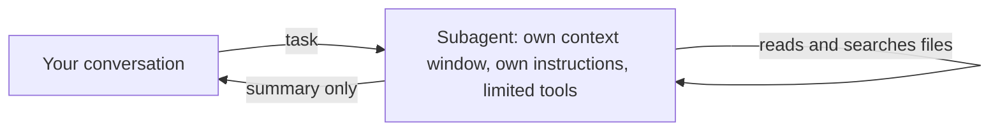

# Delegate to a custom subagent

<sub>**Intermediate** · Lesson 6 of 8 · about 20 minutes · Needs: [Permissions, settings scopes and the sandbox](04-permissions-and-sandbox.md) · Verified against Claude Code v2.1.285 (stable) on 2026-10-06</sub>

## Goal

К концу этого урока вы сможете создать субагента, обладающего только необходимыми для его задачи инструментами, и делегировать ему работу. <details style="display:inline"><summary><code>[en]</code></summary>By the end of this lesson you can write a subagent that has only the tools its task needs, and delegate work to it.</details>

## You need

- Один из ваших рабочих репозиториев и учебная копия репозитория с Node.js LTS (проверка запускается из неё). Для обеих ролей можно использовать учебную копию.
- Утилита `jq` для разбора лога делегирования в разделе Your turn.
- Расход токенов: от минимального до умеренного. Каждое делегирование создаёт отдельное контекстное окно.

## The idea

[Субагент (subagent)](https://code.claude.com/docs/en/sub-agents) - это отдельный экземпляр Claude, которому текущая сессия поручает выполнение изолированной задачи. Он работает в собственном контекстном окне, руководствуется собственными инструкциями, имеет доступ только к разрешённым вами инструментам и возвращает в основной диалог только итоговое резюме. Все его промежуточные чтения файлов и результаты поиска не засоряют вашу основную беседу: <details style="display:inline"><summary><code>[en]</code></summary>A subagent is a separate Claude that your session hands a task to. It works in its own context window, with its own instructions and only the tools you give it, and returns a summary. Its file reads and search results stay out of your conversation</details>



Субагент проекта описывается в Markdown-файле в каталоге `.claude/agents/`: блок frontmatter с обязательными полями `name` и `description`, опциональным списком инструментов `tools`, после чего следуют инструкции для субагента. Claude ориентируется на поле `description`, решая, когда делегировать задачу; вы также можете напрямую назвать субагента в промпте.

Делегируйте задачи, детальный пошаговый вывод которых не нужен в основном контексте или которые должны выполняться со строго ограниченными правами. Сохраняйте задачу в основном диалоге, если требуется интерактивное обсуждение или быстрое точечное изменение ([Choose between subagents and main conversation](https://code.claude.com/docs/en/sub-agents#choose-between-subagents-and-main-conversation)).

## Worked example

1. В вашем репозитории загрузите пример субагента [`code-reviewer`](../../examples/intermediate/06-subagents/dot-claude/agents/code-reviewer.md) и изучите его:

   ```bash
   mkdir -p .claude/agents
   curl -fsSL https://raw.githubusercontent.com/wesammustafa/Claude-Code-Everything-You-Need-to-Know/main/examples/intermediate/06-subagents/dot-claude/agents/code-reviewer.md -o .claude/agents/code-reviewer.md
   ```

   Его frontmatter ограничивает доступ тремя инструментами, позволяя читать и искать файлы, но запрещая редактирование и запуск терминальных команд:

   ```yaml
   name: code-reviewer
   tools: Read, Grep, Glob
   ```

2. Запустите `claude`. Если сессия уже была активна при создании папки `.claude/agents/`, перезапустите её: Claude Code отслеживает только папки агентов, существовавшие на момент старта ([Write subagent files](https://code.claude.com/docs/en/sub-agents#write-subagent-files)).
3. Внесите небольшое изменение в исходный код, после чего запросите ревью:

   ```text
   Use the code-reviewer agent to review my uncommitted changes.
   ```

   Во время работы в транскрипте появится строка вида `code-reviewer(Review uncommitted changes)`. Ревьюер не имеет доступа к `git diff`, поэтому он отталкивается от описания задачи из основного диалога и снимка git status ([What loads at startup](https://code.claude.com/docs/en/sub-agents#what-loads-at-startup)); в результате вы получаете сгруппированную по важности сводку замечаний. Формулировки могут различаться.

## Your turn

Создайте субагента только для чтения, который находит не покрытый тестами код, и делегируйте ему анализ.

1. Сохраните заготовку как `.claude/agents/test-gaps.md` и замените обе пометки `TODO`, предоставив агенту только инструменты для чтения:

   ```markdown
   ---
   name: test-gaps
   description: TODO
   tools: TODO
   ---

   You find code that no test exercises. You never change files.

   1. List the functions each source file exports.
   2. For each one, search the test files for a call to it.
   3. Report the functions that no test calls, grouped by file, with one line on what a test for each should check. If every function has a test, say so.
   ```

2. Закоммитьте файл в git.
3. Сохраните конфигурацию хука логирования делегирования в `.practice/i-6-hook.json`. Это хук события [`SubagentStart`](https://code.claude.com/docs/en/hooks#subagentstart), который записывает имя каждого запускаемого субагента в `.practice/i-6-agents.txt`:

   ```json
   {
     "hooks": {
       "SubagentStart": [
         { "hooks": [ { "type": "command", "command": "jq -r '.agent_type' >> \"$CLAUDE_PROJECT_DIR/.practice/i-6-agents.txt\"" } ] }
       ]
     }
   }
   ```

4. Запустите `claude --settings .practice/i-6-hook.json` и отправьте запрос: `Use the test-gaps agent to list the functions no test calls.`

## Check

Задание выполнено, когда выполняются все условия:

- [ ] Закоммиченный субагент содержит имя и описание условий вызова: `git show HEAD:.claude/agents/test-gaps.md | head -5`.
- [ ] Инструменты субагента ограничены только чтением: строка `tools` перечисляет инструменты вроде `Read`, `Grep` и `Glob` и не содержит инструментов изменения файлов или выполнения команд (`Edit`, `Write`, `Bash`).
- [ ] Claude делегировал работу субагенту: команда `grep -x test-gaps .practice/i-6-agents.txt` выводит `test-gaps`.
- [ ] Self-check (not tested): чтение файлов субагентом не попало в основной диалог, вернулась только итоговая сводка.

Запустите `npm run check -- i-6 --dir <your repo>` из учебной копии, либо `npm run check -- i-6` в самой копии.

Если первый пункт не проходит, проверьте frontmatter: Claude Code игнорирует файлы агентов без поля `name` или с указанным `name`, но без `description`. Если не проходит пункт с инструментами, удалите любые инструменты модификации файлов или запуска команд; без указания строки `tools` субагент получает полный набор инструментов. Если в логе нет `test-gaps`, запустите сессию с файлом хуков и явно укажите субагента в запросе.

## Watch out

- Субагент с доступом к `Bash` сохраняет возможность изменять файлы через команды оболочки (например, скрипты `sed` или перенаправление вывода [`> file`](https://code.claude.com/docs/en/permissions#redirections)), даже без инструментов `Edit` или `Write`. Не включайте `Bash` в список инструментов, если субагенту достаточно информации, передаваемой основным процессом.
- В macOS, Linux и WSL инструменты Glob и Grep по умолчанию скрыты, но субагент, явно объявляющий их в `tools` без указания `Bash`, получает доступ к заявленным инструментам ([Glob tool behavior](https://code.claude.com/docs/en/tools-reference#glob-tool-behavior)).
- Пользовательский субагент читает `CLAUDE.md` так же, как и основной диалог, но встроенные субагенты Explore и Plan пропускают этот файл: повторяйте критические правила в формулировке задачи, когда Claude передаёт им работу ([Check common causes](https://code.claude.com/docs/en/debug-your-config#check-common-causes)).

## Go further

- [Introduction to subagents](https://academy.claude.com/courses/introduction-to-subagents): курс Claude Academy по проектированию и использованию субагентов.
- [How and when to use subagents in Claude Code](https://claude.com/blog/subagents-in-claude-code): рекомендации Anthropic о выборе между субагентами и основным диалогом.
- [Create custom subagents](https://code.claude.com/docs/en/sub-agents): полный справочник по полям frontmatter, фоновым субагентам и возобновлению их работы.

---

<sub>Sources: [Create custom subagents](https://code.claude.com/docs/en/sub-agents) · [Hooks reference](https://code.claude.com/docs/en/hooks) · [Tools reference](https://code.claude.com/docs/en/tools-reference) · [Configure permissions](https://code.claude.com/docs/en/permissions) · [Debug your configuration](https://code.claude.com/docs/en/debug-your-config)</sub>

<sub>← [Enforce a rule with a hook](05-hooks.md) · [Intermediate index](README.md) · [Connect a tool with MCP](07-mcp.md) → · Topic: [Subagents and parallel work](../topics/subagents-and-parallel-work.md) · [Stuck on this lesson?](https://github.com/wesammustafa/Claude-Code-Everything-You-Need-to-Know/issues/new?template=lesson-feedback.yml&lesson=i-6)</sub>
