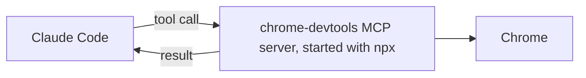

# Connect a tool with MCP

<sub>**Intermediate** · Lesson 7 of 8 · about 20 minutes · Needs: [Permissions, settings scopes and the sandbox](04-permissions-and-sandbox.md) · Verified against Claude Code v2.1.285 (stable) on 2026-10-06</sub>

## Goal

К концу этого урока вы сможете подключить MCP-сервер для себя лично, а затем предоставить к нему общий доступ всей команде на уровне проекта с фиксацией точной версии пакета. <details style="display:inline"><summary><code>[en]</code></summary>By the end of this lesson you can connect an MCP server for yourself, then share it with everyone in a project at project scope, pinned to one version.</details>

## You need

- Один из ваших рабочих репозиториев и учебная копия шаблона с Node.js LTS (проверка запускается из неё). Для обеих целей можно использовать учебную копию. Настройте папку `.practice/`, как описано в [уроке 1 уровня Beginner](../beginner/01-install-and-look-around.md#you-need), если вы ещё этого не сделали.
- Браузер Google Chrome и утилита npm (поставляется вместе с Node.js): сервер запускается через `npx` ([upstream requirements](https://github.com/ChromeDevTools/chrome-devtools-mcp/blob/chrome-devtools-mcp-v1.10.1/README.md#requirements)).
- Расход токенов: минимальный (light).

## The idea

Протокол [MCP (Model Context Protocol)](https://code.claude.com/docs/en/mcp) позволяет Claude Code использовать инструменты, предоставляемые внешними программами - серверами MCP. В этом уроке используется сервер [Chrome DevTools MCP](https://github.com/ChromeDevTools/chrome-devtools-mcp) (Vendor: Google), который запускается на вашей машине и даёт Claude инструменты для открытия веб-страниц в Chrome, чтения консоли и создания скриншотов: <details style="display:inline"><summary><code>[en]</code></summary>MCP (the Model Context Protocol) lets Claude Code use tools that another program provides: an MCP server.</details>



Область видимости (scope) определяет, кому доступен сервер ([MCP installation scopes](https://code.claude.com/docs/en/mcp#mcp-installation-scopes)):

| Scope | Кому доступен | Где сохраняется |
|---|---|---|
| Local (по умолчанию) | Вам лично в текущем проекте | `~/.claude.json` |
| Project | Всем участникам проекта | `.mcp.json` в корне проекта (в git) |
| User | Вам лично во всех проектах | `~/.claude.json` |

В интерактивной сессии Claude Code запрашивает подтверждение перед первым использованием серверов проектного уровня.

> [!WARNING]
> Передача данных за пределы компьютера. По умолчанию Chrome DevTools MCP собирает статистику использования для Google, может отправлять URL трассировок производительности в CrUX API и проверяет обновления через npm ([upstream README](https://github.com/ChromeDevTools/chrome-devtools-mcp/blob/chrome-devtools-mcp-v1.10.1/README.md)). В этом уроке сервер запускается со всеми тремя отключёнными телеметриями. Открываемые страницы загружаются из интернета, и сервер предоставляет Claude доступ ко всему содержимому этого окна браузера.

## Worked example

1. Создайте тестовую страницу для проверки в вашем репозитории:

   ```bash
   cat > .practice/demo.html <<'EOF'
   <!doctype html>
   <title>Linkcheck demo</title>
   <h1>Linkcheck demo</h1>
   <script>console.warn('demo warning from the page');</script>
   EOF
   ```

2. Подключите сервер на локальном уровне (local scope) для себя. Версия пакета зафиксирована, флаг `--isolated` запускает браузер с чистым временным профилем, а остальные флаги и переменная окружения отключают сбор статистики ([configuration](https://github.com/ChromeDevTools/chrome-devtools-mcp/blob/chrome-devtools-mcp-v1.10.1/docs/configuration.md)). Всё, что следует после `--`, является командой запуска самого сервера:

   ```bash
   claude mcp add --env CHROME_DEVTOOLS_MCP_NO_UPDATE_CHECKS=1 --transport stdio chrome-devtools -- npx -y chrome-devtools-mcp@1.10.1 --isolated --no-usage-statistics --no-performance-crux
   ```

3. Выполните команду `claude mcp get chrome-devtools`. Она выведет область видимости (local) и текущий статус сервера ([Find your configuration on disk](https://code.claude.com/docs/en/mcp-quickstart#find-your-configuration-on-disk)).
4. Запустите `claude` и выполните `/mcp`: сервер `chrome-devtools` появится в списке вместе со своими инструментами. Затем отправьте запрос:

   ```text
   Use the chrome-devtools tools to open .practice/demo.html as a file: URL, and tell me its title and console messages.
   ```

   Откроется окно Chrome, и Claude сообщит заголовок `Linkcheck demo` и предупреждение из консоли. В режиме Manual инструмент Claude Code запросит подтверждение при первом обращении к каждому новому инструменту ([Configure permissions](https://code.claude.com/docs/en/permissions#permission-modes)).

## Your turn

Предоставьте доступ к серверу всей команде на уровне проекта.

1. Удалите персональную локальную конфигурацию, которая иначе перекрывала бы сервер проекта с тем же именем: `claude mcp remove chrome-devtools -s local`.
2. Сохраните заготовку файла как `.mcp.json` в корне репозитория, заменив пометки `TODO` значениями из команды разобранного примера:

   ```json
   {
     "mcpServers": {
       "chrome-devtools": {
         "type": "stdio",
         "command": "npx",
         "args": ["-y", "TODO: the package at an exact version", "--isolated", "TODO: no usage statistics", "TODO: no CrUX lookups"],
         "env": { "TODO: the variable that turns off update checks": "1" }
       }
     }
   }
   ```

3. Закоммитьте `.mcp.json` в git.
4. Запустите `claude`. При появлении диалога о новом MCP-сервере проекта выберите согласие на использование. Команда `/mcp` покажет статус подключённости ([Edit .mcp.json directly](https://code.claude.com/docs/en/mcp-quickstart#edit-mcp-json-directly)).
5. Попросите Claude открыть `.practice/demo.html` инструментами chrome-devtools и сохранить скриншот в файл `.practice/i-7-page.png`.

## Check

Задание выполнено, когда выполняются все условия:

- [ ] Закоммиченный `.mcp.json` фиксирует точную версию пакета и отключает статистику, запросы к CrUX и проверку обновлений: `git show HEAD:.mcp.json | jq '.mcpServers["chrome-devtools"]'` отображает эти настройки.
- [ ] Сервер сохранил скриншот: команда `file .practice/i-7-page.png` подтверждает валидные данные изображения PNG.
- [ ] Self-check (not tested): после подтверждения команда `/mcp` отображает `chrome-devtools` как подключённый.

Запустите `npm run check -- i-7 --dir <your repo>` из учебной копии, либо `npm run check -- i-7` в самой копии.

Если первый пункт не проходит, сверьте каждый аргумент с командой из примера: суффикс `@latest` не фиксирует версию. Если скриншот не создан, выполните `/mcp` и проверьте соединение с сервером. Если вы случайно отклонили запрос доверия, выполните `claude mcp reset-project-choices` и перезапустите `claude` ([Project scope](https://code.claude.com/docs/en/mcp#project-scope)).

## Watch out

- Запуск `claude -p` загружает MCP-серверы проекта автоматически без интерактивного запроса подтверждения ([Project scope](https://code.claude.com/docs/en/mcp#project-scope)). Всегда проверяйте файл `.mcp.json` перед автоматизацией работы в репозитории.
- Чтобы сбросить запомненные решения по серверам проекта, используйте команду `claude mcp reset-project-choices`.

Third-party: it can run code on your machine or give Claude new tools. Review it before installing; this guide does not audit it.

Listings checked against the listing bar on 2026-10-06.

## Go further

- [Connect to MCP servers](https://code.claude.com/docs/en/mcp-quickstart): добавление удалённых серверов, авторизация и альтернативные форматы конфигурации.
- [The MCP Registry](https://registry.modelcontextprotocol.io): официальный каталог публичных MCP-серверов в статусе preview ([About](https://modelcontextprotocol.io/registry/about)).
- [What is the Model Context Protocol (MCP)?](https://modelcontextprotocol.io/docs/getting-started/intro): основы самого протокола MCP.

---

<sub>Sources: [Connect Claude Code to tools via MCP](https://code.claude.com/docs/en/mcp) · [Connect to MCP servers](https://code.claude.com/docs/en/mcp-quickstart) · [Configure permissions](https://code.claude.com/docs/en/permissions) · [Chrome DevTools MCP README](https://github.com/ChromeDevTools/chrome-devtools-mcp/blob/chrome-devtools-mcp-v1.10.1/README.md) · [Chrome DevTools MCP configuration](https://github.com/ChromeDevTools/chrome-devtools-mcp/blob/chrome-devtools-mcp-v1.10.1/docs/configuration.md) · [The MCP Registry](https://modelcontextprotocol.io/registry/about)</sub>

<sub>← [Delegate to a custom subagent](06-subagents.md) · [Intermediate index](README.md) · [Install and manage plugins](08-plugins.md) → · Topic: [MCP](../topics/mcp.md) · [Stuck on this lesson?](https://github.com/wesammustafa/Claude-Code-Everything-You-Need-to-Know/issues/new?template=lesson-feedback.yml&lesson=i-7)</sub>
